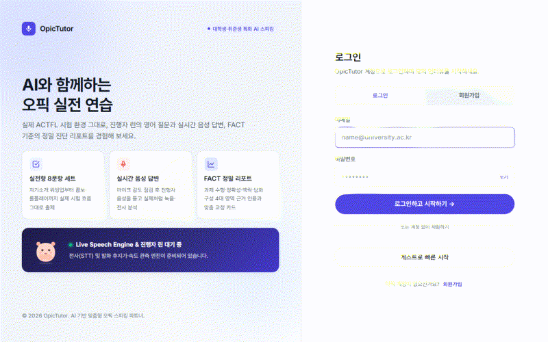
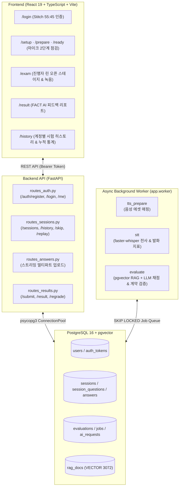

<div align="center">
  

  <h1>OpicTutor</h1>

  <p><strong>실전 8문항 음성 모의 인터뷰 &amp; ACTFL FACT 루브릭 기반 AI 정밀 피드백 플랫폼</strong></p>

  <p>
    진행자 <strong>린(Rin)</strong>의 영어 질문을 듣고 음성으로 답변하면,<br />
    로컬 Whisper 전사(STT)와 3072차원 <code>pgvector</code> RAG가 내 발화 인용문을 근거로 예상 등급(<code>NL</code>–<code>AL</code>)과 맞춤 교정 카드를 제공합니다.
  </p>

  <p>
    
    
    
    
    
  </p>

  <p>
    <a href="#-demo--preview">🎬 Demo</a> ·
    <a href="#-key-features-핵심-기능">✨ 핵심 기능</a> ·
    <a href="#️-system-architecture--tech-stack">🏗️ 시스템 아키텍처</a> ·
    <a href="#-quick-start-시작하기">🚀 시작하기</a> ·
    <a href="#-project-structure-디렉터리-구조">📂 프로젝트 구조</a> ·
    <a href="#-evaluation-principles-채점-및-설계-원칙">🔒 채점 원칙</a>
  </p>
</div>

---

## 🎬 Demo (👀 Preview)

https://github.com/user-attachments/assets/946e8a1e-212b-4089-b7de-0177b4ae00e8

> **💡 데모 시연 핵심 흐름 요약**
> 1. **Stitch 55:45 로그인 & 2단계 마이크 점검 (`/login` → `/setup`)**: 이메일/비밀번호 자체 인증(또는 게스트 시작) 후, 실시간 마이크 감도 측정과 직접 녹음 재생 확인 체크박스를 거쳐 시나리오별 8문항 세트를 준비합니다.
> 2. **오픈 스테이지 실전 모의 인터뷰 (`/exam`)**: 진행자 **린(Rin)** 의 TTS 영어 질문을 듣고 최대 1회 다시 듣기·실시간 음성 녹음·문항 건너뛰기(`Skip`)를 실제 시험과 동일한 호흡으로 진행합니다.
> 3. **AI 정밀 진단 리포트 & 계정별 시험 히스토리 (`/result` → `/history`)**: 내 답변 인용문(`Quote`) 기반의 예상 등급(`NL`–`AL`), 4대 FACT 영역 진단, 문장 교정(`Before/After`) 카드를 확인하고, 계정별로 분리된 누적 발화 시간과 회차별 등급 추이를 관리합니다.

<details>
<summary><strong>📌 데모 미디어 교체용 템플릿 코드 보기 (GIF / MP4)</strong></summary>

```html
<!-- 방법 A (GIF 애니메이션 크기 제어용 HTML) -->
<p align="center">
  
</p>

<!-- 방법 B (고화질 MP4/MOV 영상 임베딩용 HTML) -->
<p align="center">
  <video src="./docs/demo.mp4" width="800px" controls autoplay muted loop></video>
</p>
```

</details>

---

## ✨ Key Features (핵심 기능)

| 영역 | 주요 기능 설명 |
| :--- | :--- |
| **1. 자체 인증 & 계정별 히스토리 격리** | • 표준 라이브러리 `PBKDF2-HMAC-SHA256`(20만 회 반복) + Bearer 세션 토큰 기반 자체 인증(`users`, `auth_tokens`)<br>• 타 회원의 시험 세션 조회·업로드·삭제 시도 시 `403 FORBIDDEN` 차단 및 브라우저 계정 전환 시 로컬 세션 자동 초기화 |
| **2. 2단계 필수 마이크 점검 & 시나리오 출제** | • 입력 마이크 장치 선택, 실시간 볼륨 미터, 무음 경고 및 **녹음 후 직접 재생 확인 2단계 필수 체크박스 UX**<br>• 기본(집/루틴/약속)·여가·운동/건강 등 시나리오별 8문항(1번 자기소개 워밍업 + 2~8번 채점 문항) 이분 매칭 출제 |
| **3. 진행자 '린(Rin)' 오픈 스테이지 인터뷰** | • 한 화면(`100vh`)에 수렴하는 컴팩트 상단 진행률 바 + 좌측 오픈 스테이지 캐릭터 애니메이션 + 우측 녹음 타이머<br>• 문항당 **1회 다시 듣기(`Replay`)**, **질문 글 보기 토글**, 답변이 어려운 문항 **건너뛰기(`Skip`)** 지원 |
| **4. 로컬 Whisper STT & 발화 지표 계측** | • `faster-whisper (small.en)` 기반 비동기 음성 전사 및 타임스탬프 추출<br>• 실제 발화 시간(`speech_sec`), 분당 단어 수(`WPM`), 조음 속도, 장시간 침묵 횟수(`long_pause_count`), 필러 비율 자동 산출 |
| **5. RAG + FACT 루브릭 정밀 진단 리포트** | • 3072차원 `pgvector` 코사인 검색으로 루브릭·등급 대조군·업그레이드 패턴 검색 후 구조화 JSON 평가 생성<br>• **Functions/Tasks · Accuracy · Context/Content · Text Type** 4대 영역 근거 인용, 지속 수행/흔들림 분석, Before/After 교정 카드 제공 |
| **6. 내 시험 기록 & 누적 학습 통계 (`/history`)** | • 완료한 모의 인터뷰 수, 누적 실제 발화 시간, 누적 전사 완료 문항 수, 최근 예상 등급 4대 요약 KPI 카드<br>• 회차별 예상 등급 흐름 타임라인, 과거 시험 **`[리포트 보기]`** (`/result?session_id=...`), 미완료 시험 **`[이어하기]`** 지원 |

---

## 🏗️ System Architecture & Tech Stack



### 기술 스택 (Tech Stack)

| 구분 | 기술 및 라이브러리 | 역할 |
| :--- | :--- | :--- |
| **Frontend** | React 19, TypeScript, React Router v7, Vite 8, Tailwind CSS | SPA 라우팅, Stitch 디자인 시스템 UI, MediaRecorder 음성 녹음, 2초 폴링 상태 동기화 |
| **Backend API** | Python 3.12, FastAPI, Pydantic v2, Uvicorn | RESTful API(`v1`), 스트리밍 업로드 가드(`UploadRoute`), 세션 상태 머신 및 소유권 검증 |
| **Database** | PostgreSQL 16, `pgvector` (`VECTOR(3072)`), `psycopg 3` | 회원·세션·답변·평가 트랜잭션 저장, `FOR UPDATE SKIP LOCKED` 작업 큐, 3072차원 정확 코사인 검색 |
| **Speech & AI** | `faster-whisper` (`small.en`), OpenAI-compatible LLM & Embedding API, ElevenLabs TTS | 로컬 음성 전사(STT), 발화 지표 계측, RAG 문맥 검색 및 ACTFL 루브릭 기반 JSON 평가 생성 |
| **Quality & Test** | `oxlint`, TypeScript `tsc -b`, `pytest` / FastAPI `TestClient` | 프론트엔드 정적 분석(0 warnings/errors), 백엔드 계약 검증(`validate.py`) 및 인증/격리 통합 테스트 |

---

## 🚀 Quick Start (시작하기)

> [!IMPORTANT]
> 본 플랫폼은 **FastAPI 백엔드**, **비동기 STT/AI 워커**, **React 프론트엔드**가 분리된 아키텍처로 동작합니다.  
> 실행할 때 **터미널의 작업 폴더 위치(`backend/` 또는 `frontend/`)** 를 반드시 확인해 주세요.

### 사전 준비물
- **Git**, **Python 3.11+ (권장 3.12)**, **Node.js 22.12+**, **Docker Desktop (PostgreSQL + pgvector)**, 마이크가 연결된 브라우저 (또는 스마트폰)

---

### 1단계: 환경 변수 설정 (`backend/.env`)

```powershell
# 1. 저장소 클론 및 이동
git clone https://github.com/fruit8067/OpicTutor-With-AI.git
cd OpicTutor-With-AI

# 2. 백엔드 환경 변수 파일 생성 (.env.example 복사)
Copy-Item backend\.env.example backend\.env
```

`backend/.env` 파일을 열고 사용할 API 설정을 진행합니다:

- **Google AI Studio (Gemini API) 사용 시 (권장)**:
  ```ini
  LLM_BASE_URL=https://generativelanguage.googleapis.com/v1beta/openai/
  LLM_API_KEY=내_GOOGLE_STUDIO_API_KEY
  LLM_MODEL=gemini-3.5-flash-lite
  LLM_TIMEOUT_SEC=90

  EMBED_BASE_URL=https://generativelanguage.googleapis.com/v1beta/openai/
  EMBED_API_KEY=내_GOOGLE_STUDIO_API_KEY
  EMBED_MODEL=gemini-embedding-001
  EMBED_DIM=3072
  ```
- **Pickle / OpenAI 사용 시**:
  ```ini
  LLM_BASE_URL=https://llm.pcl.kr/v1
  LLM_API_KEY=내_PICKLE_API_KEY
  LLM_MODEL=pickle-general

  EMBED_BASE_URL=https://api.openai.com/v1
  EMBED_API_KEY=내_OPENAI_API_KEY
  EMBED_MODEL=text-embedding-3-large
  EMBED_DIM=3072
  ```

---

### 2단계: PostgreSQL (`pgvector`) 데이터베이스 실행

```powershell
# Docker PostgreSQL 16 (pgvector) 컨테이너 구동
docker compose up -d
```
*(Windows 드라이브 권한 이슈가 있을 경우: `docker run -d --name opictutor-with-ai-db-1 -p 127.0.0.1:5432:5432 -e POSTGRES_USER=opic -e POSTGRES_PASSWORD=opic -e POSTGRES_DB=opic -v opictutor-with-ai_pgdata:/var/lib/postgresql/data pgvector/pgvector:pg16`)*

---

### 3단계: 백엔드 가상환경 설치 및 초기 데이터 적재 (최초 1회)

```powershell
# 반드시 backend 디렉터리로 이동 후 진행
cd backend

# 가상환경 생성 및 의존성 패키지 설치
python -m venv .venv
.\.venv\Scripts\Activate.ps1
pip install -r requirements.txt

# DB 테이블 생성, 사전 합성된 TTS 에셋(242개) 등록 및 RAG 코퍼스 색인
python -c "from app.db import init_db; init_db()"
python -m scripts.import_tts static/tts/ac3049e033 --activate
python -m scripts.ingest_rag
```

---

### 4단계: 서비스 실행 (독립된 터미널에서 각각 실행)

원활한 서비스 구동을 위해 터미널을 분리하여 각각 실행합니다:

#### [터미널 1] FastAPI 백엔드 API 서버
```powershell
cd backend
.\.venv\Scripts\python.exe -m uvicorn app.main:app --host 127.0.0.1 --port 8000 --reload
```
- API 주소: http://127.0.0.1:8000
- 스웨거 API 문서: http://127.0.0.1:8000/docs

#### [터미널 2] 백그라운드 워커 (STT 음성 전사 및 AI 채점)
```powershell
cd backend
.\.venv\Scripts\python.exe -m app.worker
```

#### [터미널 3] React 프론트엔드 개발 서버
```powershell
cd frontend
npm install

# A. PC 로컬 전용 브라우저에서만 테스트할 경우:
npm run dev

# B. 스마트폰 등 외부 모바일 기기에서도 접속할 경우 (ngrok 모드):
npm run dev:ngrok
```
- 로컬 브라우저 접속: **http://127.0.0.1:5173/**

---

### 5단계: (선택) ngrok을 통한 스마트폰 모바일 접속

스마트폰 마이크로 직접 답변을 녹음하며 실전처럼 시험을 보려면 ngrok 터널을 오픈합니다.  
Vite 개발 서버가 `/api/*`와 `/media/*`를 로컬 FastAPI(`8000`)로 자동 프록시하므로 **터널 1개만** 열면 됩니다.

```powershell
# 1. ngrok 설치 및 토큰 설정 (최초 1회)
winget install ngrok.ngrok
ngrok config add-authtoken <내_AUTHTOKEN>

# 2. [터미널 4] ngrok 터널 오픈
ngrok http 5173
# (또는 발급받은 무료 고정 도메인이 있는 경우):
# ngrok http --domain=<내_고정도메인> 5173
```
- 터미널에 표시되는 **`https://<고유ID>.ngrok-free.app`** 주소로 스마트폰 브라우저에서 접속합니다.
- **HTTPS 환경**이므로 모바일 브라우저에서도 마이크 권한(`getUserMedia`)이 정상 동작합니다.
- 첫 접속 시 ngrok 안내 화면에서 **`[Visit Site]`**를 누르면 즉시 진입합니다.

---

### 💡 자주 묻는 질문 및 문제 해결 (Troubleshooting)

<details>
<summary><strong>Q1. <code>No module named uvicorn</code> 또는 <code>requirements.txt not found</code> 에러가 발생해요.</strong></summary>

- **원인**: 작업 폴더가 프로젝트 루트(`OpicTutor-With-AI`)로 되어 있을 때 발생합니다.
- **해결**: 반드시 `cd backend`로 이동한 뒤 `.\.venv\Scripts\python.exe -m uvicorn ...` 명령을 실행해 주세요.
</details>

<details>
<summary><strong>Q2. 프론트엔드 실행 시 <code>Port 5173 is already in use</code> 에러가 발생해요.</strong></summary>

- **원인**: 이전에 실행된 Vite 프로세스가 5173 포트를 점유하고 있습니다.
- **해결**: PowerShell에서 아래 명령어로 이전 프로세스를 종료 후 다시 실행합니다:
  ```powershell
  Stop-Process -Id (Get-NetTCPConnection -LocalPort 5173).OwningProcess -Force
  npm run dev:ngrok
  ```
</details>

<details>
<summary><strong>Q3. ngrok 접속 시 <code>ERR_NGROK_3200 (The endpoint is offline)</code> 오류가 떠요.</strong></summary>

- **원인**: 터널 프로그램(`ngrok http 5173`)이 실행되어 있지 않거나 종료된 상태입니다.
- **해결**: 새 터미널을 열고 `ngrok http 5173`을 실행한 뒤, 화면에 출력된 최신 주소로 접속해 주세요.
</details>

<details>
<summary><strong>Q4. ngrok 실행 시 <code>agent version is too old</code> 오류가 발생해요.</strong></summary>

- **해결**: 터미널에 `ngrok update`를 입력하여 최신 버전(3.28.0 이상)으로 업데이트합니다.
</details>

<details>
<summary><strong>Q5. 모바일에서 "질문 음성을 불러오지 못했어요" 안내가 떠요.</strong></summary>

- **원인**: 프론트엔드가 일반 `npm run dev` 모드로 켜져 있거나 ngrok 도메인 인증 페이지에 미디어가 가로채였을 때 발생합니다.
- **해결**: 프론트엔드를 반드시 **`npm run dev:ngrok`** 모드로 실행해 주세요. 최신 코드에서는 미디어 URL에 ngrok 경고 우회 파라미터가 자동으로 적용되어 오디오가 정상 재생됩니다.
</details>

---

## 📂 Project Structure (디렉터리 구조)

```text
OpicTutor-With-AI/
├── README.md                       # 프로젝트 메인 문서 (데모 영상 및 실행 가이드)
├── docker-compose.yml              # PostgreSQL 16 + pgvector 컨테이너 설정
├── docs/
│   ├── demo.mp4                    # 고화질 프로젝트 시연 영상 (MP4)
│   ├── assets/                     # 마스코트 SVG 및 문서 에셋
│   └── prompts/                    # OPIc 평가 시스템 프롬프트
├── images/
│   └── demo.gif                    # 프로젝트 시연 애니메이션 (GIF)
├── backend/
│   ├── .env.example                # 환경 변수 템플릿 (API 키 제외)
│   ├── migrations/                 # SQL 스키마 마이그레이션 (001_init ~ 006_user_history)
│   ├── app/
│   │   ├── main.py                 # FastAPI 엔트리포인트 및 라우터 마운트
│   │   ├── api/                    # REST 엔드포인트 (auth, sessions, answers, results, meta)
│   │   ├── db/                     # PostgreSQL 커넥션 풀 및 도메인별 쿼리 모듈
│   │   ├── exam/                   # 시나리오 로더 및 8문항 이분 매칭 출제기
│   │   ├── grading/                # RAG 검색, 프롬프트 조립, 계약 불변식 검증기(validate.py)
│   │   ├── stt/                    # faster-whisper 전사 및 발화 지표 계산
│   │   └── worker/                 # 비동기 작업 실행기 (tts_prepare, stt, evaluate)
│   ├── static/tts/                 # 사전 합성된 호스트·문항 음성 에셋 (242개)
│   └── tests/                      # 백엔드 단위·통합 테스트 (test_auth.py 등)
├── frontend/
│   ├── public/favicon.svg          # 진행자 '린(Rin)' 브라우저 탭 아이콘
│   └── src/
│       ├── api/                    # API 클라이언트 및 계약 타입 정의
│       ├── components/Shell.tsx    # 상단 단계 네비게이션 헤더 및 공통 레이아웃
│       ├── features/host/Host.tsx  # 진행자 '린(Rin)' 상태별 SVG 캐릭터 컴포넌트
│       └── pages/                  # Login, Setup, Prepare, Ready, Exam, Result, History
└── rag_docs/
    └── build/                      # 정제된 루브릭·질문·모범답안 코퍼스 (JSON/JSONL)
```

---

## 🔒 Evaluation Principles (채점 및 설계 원칙)

OpicTutor는 실제 시험의 신뢰도를 해치는 임의 점수화를 지양하고 다음 **계약 불변 조건(Contract Invariants)** 을 코드 수준([validate.py](backend/app/grading/validate.py))에서 강제합니다:

1. **1번 자기소개 워밍업 채점 제외**: 1번 문항(`is_scored = false`)은 연습 피드백만 제공하며 등급 산정 근거로 사용하지 않습니다.
2. **근거 인용(`Quote`) 필수 검증**: 리포트의 모든 칭찬·교정 근거는 수험생의 실제 전사문(`stt_text`)에 존재하는 문구만 인용할 수 있습니다.
3. **임의 숫자 점수·퍼센트·발음 등급 금지**: `92점`, `85%`, 발음/억양 점수 등 전사문만으로 증명할 수 없는 수치는 생성 단계와 검증 단계에서 모두 차단합니다.
4. **2단 등급 체계 및 IM 잠정 진단 표시**: ACTFL 기본 등급(`NL`, `NM`, `NH`, `IL`, `IM`, `IH`, `AL`)을 먼저 판정하고, `IM` 세분화(`IM1`·`IM2`·`IM3`) 시 반드시 `잠정 진단 — 공식 채점 아님` 라벨을 함께 표시합니다.
