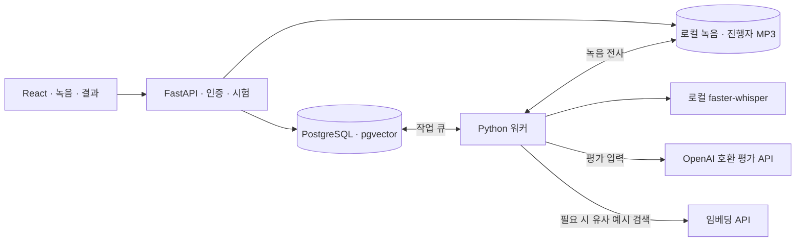

<!-- AI-assisted: PR #31의 README 초안을 바탕으로 OpenAI Codex의 도움을 받아 develop/v2 기준으로 정리했습니다. -->
<div align="center">
  

  <h1>OpicTutor</h1>

  <p><strong>영어로 말하는 8문항 모의 인터뷰, 내 답변을 근거로 받는 AI 피드백</strong></p>

  <p>진행자 질문을 듣고 답하면, 시험이 끝난 뒤 예상 등급과 다음 연습 과제를 확인할 수 있습니다.</p>

  <p>
    <a href="#시작하기">시작하기</a> ·
    <a href="#시험-흐름">시험 흐름</a> ·
    <a href="#시스템-구성">시스템 구성</a> ·
    <a href="#문제-해결">문제 해결</a> ·
    <a href="#개발-문서">개발 문서</a>
  </p>
</div>

이 문서는 `develop/v2`의 **로컬 개발 환경**을 기준으로 합니다. 예상 등급은 OPIc 연습용입니다. 평가는 전사문과 발화 지표를 바탕으로 하며 발음·억양은 채점 범위에서 제외합니다.

## 시험 흐름

| 단계 | 할 수 있는 일 |
| --- | --- |
| **시작** | 이메일로 가입하거나 로그인합니다. 게스트로도 시험을 시작할 수 있습니다. |
| **마이크 점검** | 입력 장치를 선택하고 실시간 음량을 확인합니다. 테스트 녹음은 브라우저에서 재생한 뒤 듣기 확인을 체크합니다. |
| **모의 인터뷰** | 기본·여가·운동/건강 중 시나리오를 골라 8문항을 진행합니다. 질문을 한 번 다시 듣거나 문항을 건너뛸 수 있습니다. 자기소개 1번에는 연습 피드백만 제공합니다. |
| **종합 평가** | 로컬 Whisper가 녹음을 전사합니다. 시험을 제출하면 채점 대상 답변을 모아 AI 평가를 요청합니다. 건너뛴 문항은 평가 근거에서 제외합니다. |
| **결과 리포트** | 예상 등급(NL–AL), FACT 진단, 답변 인용, 문항별 개선안과 다음 연습 질문을 확인합니다. IM1–IM3은 내부 기준에 따른 잠정 진단입니다. |

시험 중 새로고침하면 브라우저에 저장된 세션을 이어갈 수 있습니다. 평가가 실패하면 저장된 답변으로 **평가 다시 하기**를 선택할 수 있습니다.

## 시작하기

**준비물**은 Git, Python 3.11 이상, Node.js 22.12 이상, Docker Compose, 마이크가 있는 브라우저입니다. 전체 채점 흐름을 사용하려면 평가 API 키와 임베딩 API 키가 필요합니다.

### 1. 설치와 환경 설정

Windows PowerShell에서 다음 명령을 실행합니다.

```powershell
git clone --branch develop/v2 https://github.com/fruit8067/OpicTutor-With-AI.git
Set-Location OpicTutor-With-AI

docker compose up -d --wait db
python -m venv backend/.venv
& .\backend\.venv\Scripts\python.exe -m pip install -r backend/requirements.txt
npm.cmd --prefix frontend ci

if (-not (Test-Path backend/.env)) {
    Copy-Item backend/.env.example backend/.env
}
```

<details>
<summary>macOS / Linux 설치 명령</summary>

```bash
git clone --branch develop/v2 https://github.com/fruit8067/OpicTutor-With-AI.git
cd OpicTutor-With-AI

docker compose up -d --wait db
python3 -m venv backend/.venv
backend/.venv/bin/python -m pip install -r backend/requirements.txt
npm --prefix frontend ci
test -f backend/.env || cp backend/.env.example backend/.env
```

</details>

[`backend/.env.example`](backend/.env.example)을 참고해 **`backend/.env`**를 설정합니다. 앞에 점이 있는 파일명입니다.

| 설정 | 용도와 기본값 |
| --- | --- |
| `LLM_API_KEY` 또는 `PICKLE_API_KEY` | 평가 제공자 키. 기본 제공자는 `https://llm.pcl.kr/v1`, 모델은 `pickle-general`입니다. `LLM_API_KEY`가 비어 있으면 `PICKLE_API_KEY`를 사용합니다. |
| `EMBED_API_KEY` | 코퍼스 임베딩과 유사 예시 검색에 쓰는 별도 키. 기본 모델은 `text-embedding-3-large`이며 3072차원을 사용합니다. |
| `DATABASE_URL` | 기본값은 Docker Compose의 로컬 `opic` DB에 연결합니다. 다른 개발 DB를 쓰는 경우 변경합니다. |
| `DATA_DIR`, `TTS_DIR`, `RAG_BUILD_DIR` | 녹음, 음성 파일, 코퍼스 경로. `backend/` 기준 상대 경로를 사용합니다. |

키는 `.env`에 넣고 Git에는 포함하지 않습니다. 이미 실행 중인 backend와 worker에 환경 설정을 반영하려면 두 프로세스를 재시작합니다.

### 2. DB, 진행자 음성, 검색 데이터 준비

저장소 루트에서 PowerShell로 실행합니다.

```powershell
Set-Location backend
& .\.venv\Scripts\python.exe -c "from app.db import init_db; init_db()"
& .\.venv\Scripts\python.exe -m scripts.import_tts ./static/tts/ac3049e033 --activate
& .\.venv\Scripts\python.exe -m scripts.ingest_rag --dry-run
```

DB 초기화는 기존 데이터에 마이그레이션을 적용합니다. `import_tts`는 저장소에 포함된 진행자 MP3를 DB에 등록하고 활성화합니다. `--dry-run` 출력에서 처리할 문서 수와 비용 추정치를 확인한 뒤 실제 임베딩을 실행합니다.

```powershell
# backend/에서 실행. 미적재 문서가 있으면 외부 임베딩 요청이 발생합니다.
& .\.venv\Scripts\python.exe -m scripts.ingest_rag
```

macOS/Linux에서는 `.\.venv\Scripts\python.exe` 대신 `./.venv/bin/python`으로 같은 모듈을 실행합니다.

### 3. PowerShell 창 3개에서 실행

아래 각 블록을 **저장소 루트에서 시작하는 별도 터미널**에서 실행합니다.

```powershell
# Backend · http://127.0.0.1:8000
Set-Location backend
& .\.venv\Scripts\python.exe -m uvicorn app.main:app --host 127.0.0.1 --port 8000
```

```powershell
# Worker · 음성 준비, 전사, 평가
Set-Location backend
& .\.venv\Scripts\python.exe -m app.worker
```

```powershell
# Frontend · http://127.0.0.1:5173
Set-Location frontend
npm.cmd run dev -- --host 127.0.0.1 --port 5173 --strictPort
```

macOS/Linux에서는 `cd`, `./.venv/bin/python`, `npm`을 사용합니다. 워커는 처음 실행할 때 Whisper 모델을 내려받을 수 있습니다.

**[앱 열기](http://127.0.0.1:5173)** · [로그인](http://127.0.0.1:5173/login) · [API 문서](http://127.0.0.1:8000/docs) · [상태 확인](http://127.0.0.1:8000/api/v1/health)

## 시스템 구성



API는 음성 준비·전사·평가를 작업 큐에 넣고, 브라우저는 결과가 저장될 때까지 상태를 조회합니다. 진행자 음성은 [OmniVoice 노트북](colab/omnivoice_tts.ipynb)으로 미리 생성한 파일입니다. 답변 원음은 로컬에서 전사하고, 평가 제공자에는 전사문과 발화 지표를 포함한 평가 입력을 전달합니다. pgvector의 예시 검색은 [평가 기준](docs/prompts/opic_evaluation_system.md)을 보조합니다.

| API | 주요 경로 · `/api/v1` 기준 |
| --- | --- |
| 계정 | `POST /auth/register`, `POST /auth/login`, `GET /auth/me`, `POST /auth/logout` |
| 시험 | `POST /sessions`, `POST /sessions/{session_id}/start`, `GET /sessions/{session_id}/current` |
| 답변 | `POST /sessions/{session_id}/answers`, `POST /sessions/{session_id}/questions/{order_no}/replay`, `POST /sessions/{session_id}/questions/{order_no}/skip` |
| 결과 | `POST /sessions/{session_id}/submit`, `GET /sessions/{session_id}/result`, `POST /sessions/{session_id}/regrade` |

## 문제 해결

| 증상 | 확인할 항목 |
| --- | --- |
| 회원가입이나 로그인 요청 실패 | 최신 `develop/v2`에서 backend를 실행하고 [API 문서](http://127.0.0.1:8000/docs)에 `/auth/login`이 있는지 확인합니다. |
| 시험 준비에서 멈춤 | 워커 실행 여부와 [상태 응답](http://127.0.0.1:8000/api/v1/health)의 `db`, `corpus_version`, `tts.voice_id`, `tts.missing_pilot`을 확인합니다. |
| 키를 넣었는데 임베딩 키 오류가 남 | 파일명이 `backend/.env`인지 확인하고 `EMBED_API_KEY`에 임베딩 제공자 키를 설정합니다. |
| 평가 실패 | 평가 제공자 키와 사용량 한도를 확인합니다. 해결 후 결과 화면에서 **평가 다시 하기**를 누르면 저장된 답변을 사용합니다. |

## 개발 문서

| 경로 | 내용 |
| --- | --- |
| [`frontend/`](frontend/) | React, Vite, TypeScript 기반 시험 UI |
| [`backend/`](backend/) | FastAPI, 워커, PostgreSQL 마이그레이션과 테스트 |
| [코퍼스 구성과 빌드](rag_docs/README.md) | 문항, 시나리오, 대조 답변과 생성 절차 |
| [요구사항](docs/REQUIREMENTS_v2.md) · [사용 흐름](docs/FLOWCHART.md) | 제품 범위와 상태 전이 |
| [API 설계](docs/API_SPEC.md) · [모듈 계약과 소유권](agents/contracts.yaml) | API와 모듈 경계의 설계 문서. 실행 중인 경로는 FastAPI의 `/docs`에서 확인합니다. |
| [TTS 작업 절차](docs/handoff/tts-host.md) | 새 질문과 진행자 음성 생성 및 반입 |

Frontend 검증은 `frontend/`에서 `npm run lint`, `npm run build`로 실행합니다. Backend 테스트는 별도 개발 DB를 준비하고 backend 가상환경에 `pytest`를 설치한 뒤 `backend/`에서 `python -m pytest`로 실행합니다. PR에서 모듈 경계를 변경할 경우 경로별 소유권과 계약을 확인합니다.

## 라이선스

[GNU General Public License v3.0](LICENSE). 연습 문항과 대조 답변은 교육용이며 공식 시험 문제나 채점 답안이 아닙니다.
