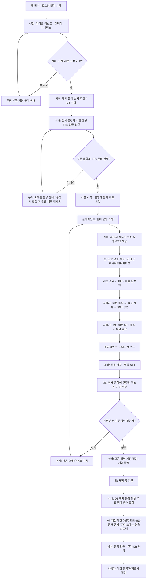
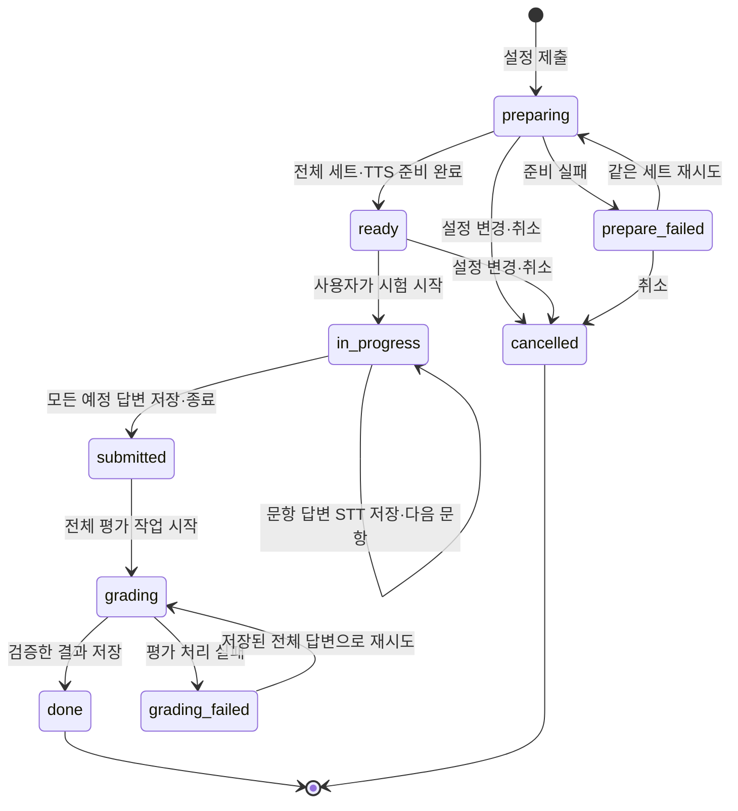

# OpicTutor — 모의고사 사용자 흐름

> 갱신: 2026-11-06
> 기준: [REQUIREMENTS_v2.md](REQUIREMENTS_v2.md) · 요약: [PROJECT_REQUIREMENTS.md](../PROJECT_REQUIREMENTS.md)
> **설정 단계에서 전체 문제 세트·순서·TTS를 준비하고, 시험 중에는 정해진 문항을 순서대로 제공한다.**

## 1. 사용자 흐름



기본 8문항은 자기소개 워밍업 1개와 채점 대상 7개다. 전체 문항을 설정에서 확정하고 8답변 모두 저장한다. 서버는 `is_scored`·요구 기능·시간대·맥락을 함께 전달하며 AI와 출력 검증기는 자기소개를 등급 근거에서 제외한다. 자기소개 연습 피드백은 별도 표시한다.

그림의 시험 부분은 정상 흐름이다. 업로드·STT 실패 시 현재 문항에서 복구하고 다음 문항으로 넘어가지 않는다. 준비 실패 시 문제 세트를 재추첨하지 않는다. 자세한 예외는 5절을 따른다.

## 2. 단계별 기술·AI·DB

| 단계 | 화면·사용자 | 서버·기술 | AI request | DB 읽기·쓰기 |
| --- | --- | --- | --- | --- |
| 접속 | 더미 로그인, 로그인 없이 진입 | React | 없음 | 없음 |
| 설정 | 마이크 테스트·시나리오 선택 | getUserMedia, Web Audio | 없음 | 지원 시나리오·문항 메타 조회; 테스트 음성 저장 안 함 |
| 세트 준비 | 준비 중 | FastAPI 출제 규칙 | 출제 LLM 없음 | 설정·세션·전체 문항·순서·버전·채점 여부·과제 태그 저장 |
| TTS 준비 | 전체 음성 준비 상태 | 사전 생성 음성 캐시 검증 | 세션 준비 중 호출 없음; 운영자가 OmniVoice/Colab에서 사전 생성 | 해시 확인·자산 연결·ready 저장 |
| 문항 요청 | 현재 문항 확인 | FastAPI·HTML audio | 없음 | 확정 문항·TTS 조회 |
| 문항 재생 | 캐릭터가 말함 | audio 이벤트·CSS/SVG | 없음 | 재생 횟수 상태 관리 |
| 녹음 | 같은 버튼으로 시작·종료 | MediaRecorder | 없음 | 제출 전 녹음은 브라우저 메모리 |
| 업로드·STT | 답변 처리 중 | 파일 저장·로컬 워커 | 로컬 STT 추론 | 원음 경로·텍스트·지표·STT 상태 저장 |
| 문항 전환 | 다음 문항 | 서버 순서 계산 | 없음 | STT 성공과 현재 순서 갱신 |
| 종료 | 채점 중 | 전체 답변 완결성 확인 | 아직 없음 | submitted·채택 답변 ID 고정 |
| 평가 준비 | 채점 중 | SQL·필요 시 pgvector | 검색 벡터가 없을 때 임베딩 | 전체 시험·루브릭·대조 예시 조회 |
| 종합 평가 | 채점 중 | LLM·Pydantic 검증 | 시험 단위 평가·피드백 기본 1회 | 평가 실행·모델·근거 버전·결과 저장 |
| 결과 | 예상 등급·피드백 | React·FastAPI | 없음 | 저장 결과 조회 |

**AI가 직접 DB를 가져오는 구조가 아니다. 서버가 해당 세션 데이터와 근거를 조회해 AI에 전달한다.**

## 3. 클라이언트·서버·DB·AI 시퀀스

```mermaid
sequenceDiagram
    actor User as 사용자
    participant Web as 웹
    participant Server as 서버·워커
    participant DB as PostgreSQL
    participant TTS as OmniVoice·Colab
    participant STT as 로컬 STT
    participant LLM as 평가 AI

    Note over Server,TTS: 운영자가 시험 전에 음성을 생성·반입하는 별도 작업
    TTS-->>Server: 사전 생성 mp3·manifest 반입
    Server->>DB: 음성 자산 등록
    User->>Web: 마이크 테스트·선택적 시나리오 설정
    Web->>Server: 설정 제출
    Server->>Server: 지원 조건 검증·전체 문제 세트 확정
    Server->>DB: 세션·설정·전체 문항·순서 저장
    Server->>DB: 문항별 TTS 캐시 조회
    Note over Web,Server: 누락·해시 불일치면 prepare_failed; 운영자 반입 후 같은 세트 재시도
    Server->>DB: 모든 음성이 유효할 때만 문항에 연결
    Server->>DB: 전체 준비 확인·ready
    Server-->>Web: 준비 완료
    User->>Web: 시험 시작
    Web->>Server: 시험 시작 요청
    Server->>DB: ready 확인·in_progress

    loop 미리 확정한 순서대로 각 문항
        Web->>Server: 현재 문항 요청
        Server->>DB: 현재 문항 스냅샷·TTS 조회
        Server-->>Web: 문항·음성 재생 정보
        Web-->>User: 문항 음성 재생·캐릭터 애니메이션
        User->>Web: 마이크 버튼 → 답변 → 같은 버튼으로 종료
        Web->>Server: 녹음 업로드
        Server->>DB: 원음 경로·STT 대기 작업 저장
        Server-->>Web: 접수 완료·현재 문항 유지
        Server->>STT: 저장 녹음 전사
        STT-->>Server: 텍스트·타임스탬프
        Server->>DB: 문항 연결 답변·지표 저장·순서 갱신
        Web->>Server: 답변 처리 상태 조회
        Server-->>Web: STT 저장 성공·남은 문항 여부
    end

    Web->>Server: 마지막 답변 저장 후 종료 요청
    Server->>DB: 모든 예정 답변 확인·채택 ID 고정·submitted
    Server->>DB: 평가 작업 등록·grading
    Server-->>Web: 채점 중
    Server->>DB: 전체 문제·답변·지표·평가 근거 조회
    DB-->>Server: 해당 시험의 전체 평가 입력
    Server->>LLM: 전체 입력 + 채점 여부·과제 태그 + 고정 시스템 프롬프트 + 출력 스키마
    Note over Server,LLM: 자기소개는 연습 피드백만; 종합 등급 근거는 나머지 7문항
    LLM-->>Server: 예상 등급·근거·피드백
    Server->>Server: 구조·범위·인용 근거 검증
    Server->>DB: 결과 저장·done
    Web->>Server: 결과 조회
    Server-->>Web: 저장된 결과
    Web-->>User: 예상 등급·피드백 표시
```

상태 조회는 필요한 동안 반복한다. TTS 캐시 준비·STT·평가는 워커 작업이며 요청을 오래 열어 두는 방식이 아니다. TTS 음성 생성 자체는 운영자의 사전 Colab 작업이다. STT 처리 중 UI는 현재 문항에 머문다.

## 4. 상태와 진행 조건



- preparing은 설정 단계의 연장이다. 문제 세트를 확정하고 음성을 준비한다.
- ready는 문제 세트와 모든 문항 음성이 준비됐다는 뜻이다.
- in_progress에서 STT 실패는 현재 문항에서 복구한다. 성공 전 순서를 전진시키지 않는다.
- submitted는 마지막 업로드 접수만으로 도달하지 않는다. 전체 답변 텍스트 저장을 확인한다.
- done은 기술적으로 결과 처리 완료다. 판단 근거가 부족하면 등급 대신 평가 불가 사유를 표시할 수 있다.

## 5. 예외 흐름

| 상황 | 돌아갈 위치 | 유지하는 것 |
| --- | --- | --- |
| 시나리오 문항 부족 | 설정 변경 | 불완전한 시험은 시작하지 않음 |
| TTS 준비 실패 | 누락·변경 음성을 운영자가 재생성·반입한 후 준비 재시도 | 확정한 전체 문항·순서 |
| TTS 재생 실패 | 현재 문항 재생 | 현재 문항; 텍스트만으로 진행하지 않음 |
| 녹음·업로드 실패 | 현재 문항 재녹음·재전송 | 확정 세트 |
| STT 오류 | 저장 음성 재처리 | 현재 문항·원음 |
| 무음·손상 | 현재 문항 재녹음 | 실패 시도 이력 |
| AI 평가 실패 | 종료 후 평가 재시도 | 전체 문항·답변·지표 |
| 결과 새로고침 | DB 결과 조회 | 저장 결과; AI 재호출 없음 |

## 6. 세 문서의 공통 기준

1. 설정 단계에서 전체 problem set을 준비한다.
2. 시험 중 서버는 그 세트의 다음 문항을 조회한다.
3. 사용자는 캐릭터와 함께 재생되는 TTS를 듣는다. 내부 음성 파일 캐시는 허용한다.
4. 답변마다 STT 저장이 완료된 뒤 진행한다.
5. 마지막 답변 저장 후에만 전체 등급 평가·피드백을 시작한다.
6. 채팅·재연습은 모의고사 주 흐름의 필수 단계가 아니다.

기존 [API_SPEC.md](API_SPEC.md)는 아직 이전 방식이다. 상세 요구사항 8장의 동기화 목록에 따라 구현 계약을 갱신해야 한다.

사전 TTS 생성 방식은 원격 OmniVoice 변경을 반영했다. 세션 설정 단계의 전체 문제 세트 확정·음성 준비 완료 조건은 그대로 유지한다.
